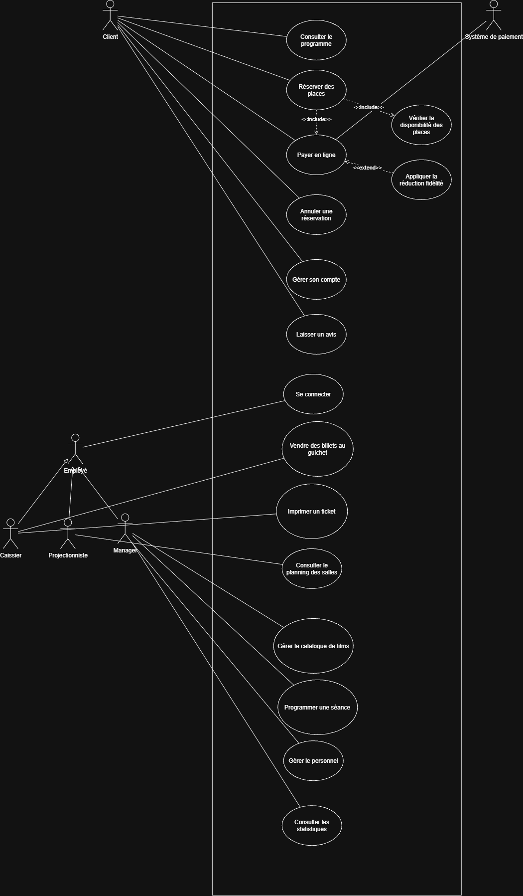
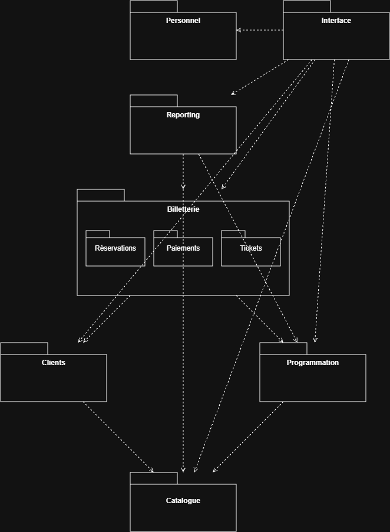
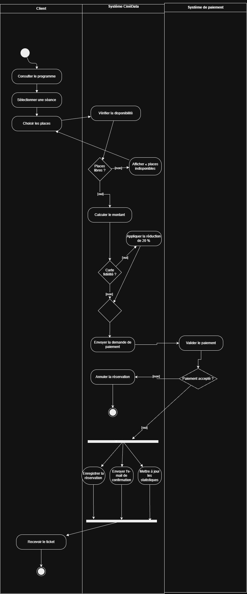
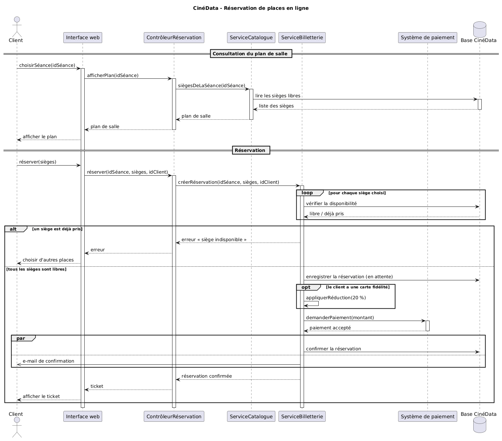
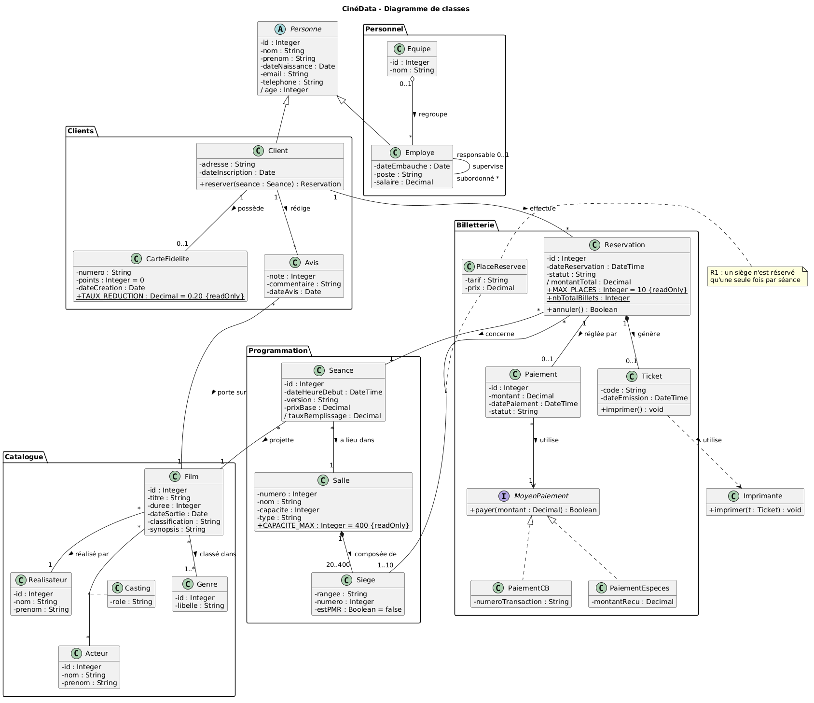
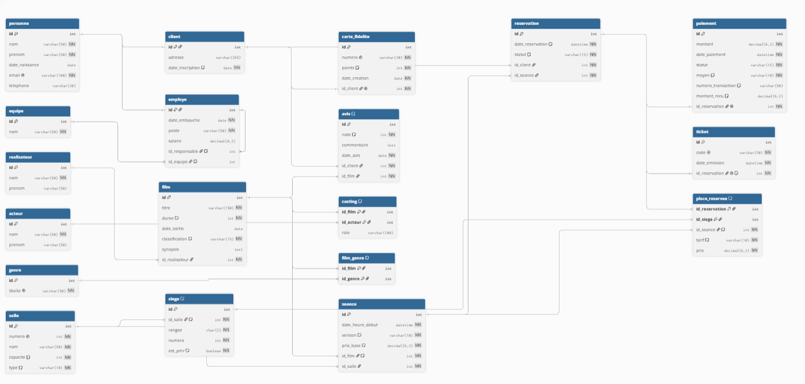

# 🎬 CinéData

**Base de données complète d'un cinéma multiplexe** : de l'analyse des besoins jusqu'à l'optimisation, en passant par trois paradigmes de bases de données (relationnel, objet-relationnel et document).

Projet pratique réalisé pour appliquer l'ensemble du cours *Introduction aux bases de données* (Studi) : modélisation UML, normalisation, SQL (DDL, DML, DCL, TCL), sécurité, optimisation, PostgreSQL et MongoDB.


---

## 📋 Sommaire
1. [Le contexte](#-le-contexte)
2. [Modélisation](#-modélisation)
3. [Base relationnelle (MariaDB)](#️-base-relationnelle-mariadb)
4. [Objet-relationnel (PostgreSQL)](#-objet-relationnel-postgresql)
5. [Orienté document (MongoDB)](#-orienté-document-mongodb)
6. [Résultats clés](#-résultats-clés)
7. [Structure du dépôt](#-structure-du-dépôt)
8. [Installation et exécution](#️-installation-et-exécution)
9. [Compétences mobilisées](#-compétences-mobilisées)

---

## 🎯 Le contexte

Le cinéma fictif **« Le Grand Écran »** gérait sa programmation et sa billetterie dans des tableurs. CinéData centralise :
- le **catalogue** (films, genres, réalisateurs, acteurs) ;
- la **programmation** (salles, sièges, séances) ;
- la **billetterie** (réservations, places, paiements, tickets) ;
- les **clients** (comptes, fidélité, avis) et le **personnel** (hiérarchie, équipes) ;
- les **statistiques** (chiffre d'affaires, taux de remplissage, films les plus vus).

Le [cahier des charges](docs/01_cahier_des_charges.md) définit **10 règles métier** (R1 à R10) que la base fait respecter elle-même, par exemple :
- **R1** : un siège ne peut être réservé qu'une seule fois par séance ;
- **R3** : deux séances ne peuvent pas se chevaucher dans la même salle ;
- **R6** : un client doit avoir l'âge requis par la classification du film.

---

## 📐 Modélisation

### Diagramme de cas d'utilisation
Acteurs, généralisation d'acteurs, `<<include>>` et `<<extend>>`.



### Diagramme de paquetages
7 modules, 3 sous-paquetages, des dépendances unidirectionnelles sans cycle.



### Diagramme d'activités : la réservation
Couloirs, décisions, boucle, fusion, bifurcation et jonction (actions parallèles).



### Diagramme de séquence : la réservation
Écrit en PlantUML : lignes de vie, messages synchrones et asynchrones, fragments `loop`, `alt`, `opt` et `par`.



### Diagramme de classes
Classe abstraite, héritage, composition, agrégation, classes d'association, association réflexive, interface, attributs dérivés et constantes.



### Normalisation et passage au relationnel
- [Normalisation](docs/07_normalisation.md) : d'un export Excel redondant aux formes normales **1FN, 2FN, 3FN et BCNF**, pour retomber sur le diagramme de classes.
- [Passage UML → relationnel](docs/08_passage_relationnel.md) : règles de transformation, comparaison des **3 stratégies d'héritage**, dénormalisation volontaire et justifiée (R1).



---

## 🗄️ Base relationnelle (MariaDB)

**19 tables**, toutes les contraintes nommées (`pk_`, `fk_`, `uq_`, `chk_`).

| Script | Contenu | Notions |
|---|---|---|
| [`00_setup.sql`](sql/00_setup.sql) | base et utilisateur dédié | `CREATE DATABASE`, `CREATE USER`, `GRANT` |
| [`01_create.sql`](sql/01_create.sql) | les 19 tables | PK, FK (`CASCADE`, `RESTRICT`, `SET NULL`), `UNIQUE`, `CHECK`, `DEFAULT` |
| [`02_alter.sql`](sql/02_alter.sql) | évolution de structure | `ALTER TABLE` (ADD, MODIFY, CHANGE), `TRUNCATE`, `DROP` |
| [`03_seed.sql`](sql/03_seed.sql) | jeu de données (600 sièges, 16 réservations…) | `INSERT` multi-lignes, `INSERT … SELECT`, `CROSS JOIN`, `CASE` |
| [`04_requetes.sql`](sql/04_requetes.sql) | 26 requêtes en 5 niveaux | `WHERE`, agrégats, `GROUP BY`/`HAVING`, jointures, sous-requêtes, indicateurs métier |
| [`05_update_delete.sql`](sql/05_update_delete.sql) | 11 démonstrations | `UPDATE` avec jointure et `CASE`, `DELETE` en cascade, `ROLLBACK` |
| [`06_transactions.sql`](sql/06_transactions.sql) | procédure `reserver_place` | `START TRANSACTION`, `SAVEPOINT`, `COMMIT`, `ROLLBACK`, gestionnaire d'erreur |
| [`07_roles.sql`](sql/07_roles.sql) | 3 rôles, 3 utilisateurs | `CREATE ROLE`, `GRANT`, `REVOKE`, moindre privilège |
| [`08_vues.sql`](sql/08_vues.sql) | 3 vues | masquage des données personnelles, simplification, indicateurs |
| [`09_optimisation.sql`](sql/09_optimisation.sql) | performance et robustesse | `EXPLAIN`, index, CTE récursive, triggers, 11 tests automatisés |

### Sécurité : démonstration d'injection SQL ([`app/`](app/))
Deux pages PHP de recherche de client :
- une version **vulnérable** (concaténation) : la saisie `' OR '1'='1` affiche **tous les clients** ;
- une version **sécurisée** (requête préparée PDO) : la même saisie renvoie **0 résultat**.

Le mot de passe de connexion est stocké dans `app/config.php`, **exclu du dépôt** par `.gitignore` (modèle fourni : `config.example.php`).

---

## 🐘 Objet-relationnel (PostgreSQL)

Script [`pg/10_objet_relationnel.sql`](pg/10_objet_relationnel.sql) :
- **types composés** (`adresse_t`) et **énumérations** (`classification_t`) ;
- **héritage natif** `client INHERITS (personne)` et requêtes **polymorphes** ;
- **méthodes** : fonctions appelables comme des attributs (`p.age_annees`) ;
- **tableaux** (`tags TEXT[]`, `ANY`, `@>`, `unnest`) et **JSONB** ;
- fonction **PL/pgSQL** et **trigger** qui refuse la vente quand la séance est complète.

> **Limite mise en évidence :** sous PostgreSQL, `UNIQUE` ne s'applique pas à l'ensemble d'une hiérarchie d'héritage. Un même e-mail a été accepté dans `client` et dans `employe`, ce que la stratégie relationnelle classique empêchait.

---

## 🍃 Orienté document (MongoDB)

Script [`mongo/11_avis_nosql.js`](mongo/11_avis_nosql.js), sur les **avis clients** et les **journaux de navigation** (données à structure variable) :
- documents hétérogènes, **sous-documents** et **tableaux imbriqués** ;
- `find` (filtres, projection, tri), `updateOne` (`$set`, `$inc`, `$push`) ;
- **pipeline d'agrégation** : note moyenne par film, tags populaires, **entonnoir de conversion** ;
- **validation** `$jsonSchema` ;
- **index** et `explain` (`COLLSCAN` → `IXSCAN`).

La synthèse des paradigmes et les choix d'architecture sont détaillés dans [**docs/12_comparaison_paradigmes.md**](docs/12_comparaison_paradigmes.md) : les données financières restent en relationnel, les avis et les journaux vont en document (persistance polyglotte).

---

## 📊 Résultats clés

| Mesure | Résultat |
|---|---|
| Tests automatisés de contraintes et triggers | **11 / 11 réussis** |
| Procédure de réservation | 7 scénarios : succès, siège pris, âge, paiement refusé, erreurs |
| Index MariaDB | `type = ALL` (≈ 600 lignes) → `type = ref` (quelques lignes) |
| Index MongoDB | `COLLSCAN` (7 documents) → `IXSCAN` (2 documents) |
| Injection SQL | 9 clients exposés (version vulnérable) → 0 (requête préparée) |
| Chiffre d'affaires par moyen de paiement | carte : **82 %**, espèces : 18 % |
| Entonnoir de navigation (MongoDB) | 3 sessions → 2 ajouts au panier → 1 paiement |

Les sorties complètes de chaque script sont versionnées à côté de lui (`*_resultats.txt`).

---

## 📁 Structure du dépôt

```
cinedata/
├── docs/        Cahier des charges, diagrammes UML (.drawio / .puml + .png),
│                normalisation, passage au relationnel, comparaison des paradigmes
├── sql/         Scripts MariaDB numérotés (00 à 09) et leurs résultats
├── pg/          Script PostgreSQL objet-relationnel et ses résultats
├── mongo/       Script MongoDB et ses résultats
└── app/         Démonstration PHP de l'injection SQL (vulnérable / sécurisée)
```

---

## ⚙️ Installation et exécution

### Prérequis
- MariaDB 10.4+ ou MySQL 8 (testé avec XAMPP)
- PostgreSQL 15+ (testé avec PostgreSQL 18)
- MongoDB 7+ et mongosh (testé avec MongoDB 9 et mongosh 2.13)
- PHP 8 (pour la démonstration `app/`)

### MariaDB
```bash
# 1. En administrateur (root) : base et utilisateur
#    -> remplacer A_REMPLACER dans 00_setup.sql par un mot de passe
mysql -u root -p < sql/00_setup.sql

# 2. Avec l'utilisateur cinedata_dev, dans l'ordre
mysql -u cinedata_dev -p cinedata
```
```sql
SOURCE sql/01_create.sql;
SOURCE sql/02_alter.sql;
SOURCE sql/03_seed.sql;
SOURCE sql/04_requetes.sql;
SOURCE sql/05_update_delete.sql;
SOURCE sql/06_transactions.sql;
```
Puis, **en root** : `07_roles.sql` et `08_vues.sql`, et enfin avec `cinedata_dev` : `09_optimisation.sql`.

> ⚠️ Les comptes créés par `07_roles.sql` (`caisse_yasmine`, `manager_helene`, `analyste_data`) utilisent des **mots de passe de démonstration** destinés à un environnement local. Ils ne doivent jamais être utilisés sur un serveur accessible.

### PostgreSQL
```bash
psql -U postgres -d postgres -f pg/10_objet_relationnel.sql
```
Le script crée lui-même la base `cinedata_pg`.

### MongoDB
```bash
mongosh --file mongo/11_avis_nosql.js
```
Le script crée la base `cinedata_nosql`.

### Démonstration PHP
```bash
cp app/config.example.php app/config.php   # puis renseigner le mot de passe
php -S localhost:8000 -t app
```
Puis ouvrir http://localhost:8000.

---

## 🧠 Compétences mobilisées

- **Analyse et modélisation** : cahier des charges, règles métier, UML (cas d'utilisation, paquetages, activités, séquence, classes)
- **Conception de bases de données** : normalisation (1FN → BCNF), passage UML → relationnel, stratégies d'héritage, dénormalisation justifiée
- **SQL avancé** : DDL, DML, jointures, sous-requêtes, CTE récursives, vues, procédures stockées, triggers, transactions
- **Sécurité** : rôles et moindre privilège, masquage de données personnelles, prévention de l'injection SQL, gestion des secrets
- **Performance** : index, plans d'exécution (`EXPLAIN`)
- **Analyse de données** : chiffre d'affaires, taux de remplissage, segmentation client, entonnoir de conversion
- **Multi-SGBD** : MariaDB, PostgreSQL (objet-relationnel), MongoDB (NoSQL), et le choix argumenté entre eux
- **Outillage** : Git (historique par phase), draw.io, PlantUML, dbdiagram.io, ligne de commande

---

## 👤 Auteur

**Ahcene Madjour** : développeur web et data analyst

[](https://github.com/AHCENEM)
[](https://www.linkedin.com/in/ahcene-madjour)

*Toutes les données (films, personnes, réservations) sont fictives.*
